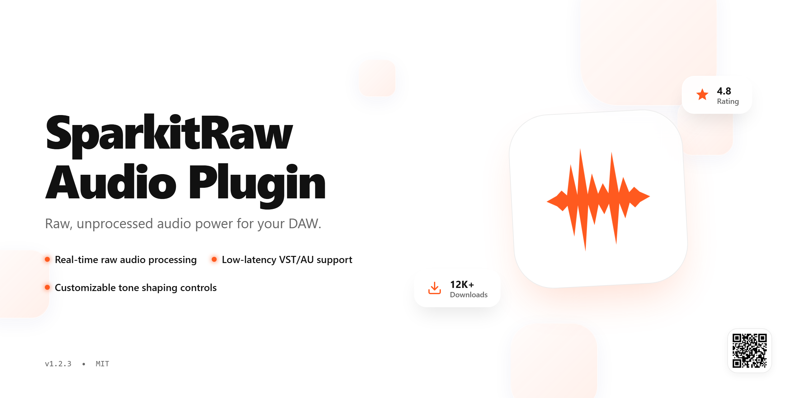

# 🎛️ SparkitRaw: Chord-Hold Arp Workflow — Video Tool

### 🔧 PowerShell Setup Button

   

---

SparkitRaw is a MIDI arpeggiator built around a single, tactile gesture: hold a chord and the pattern blooms, release and it vanishes. One oversized ENERGY knob carries the whole performance—nudge it upward and the note rate tightens, the range stretches across octaves, and the motion shifts from a clean upward sweep into a tumbling up-and-down figure, all while the Fire Head mascot climbs and sparks with every triggered note. Non-note MIDI such as pitch bend and CC slips through untouched, so the plugin folds into an existing chain without disrupting what surrounds it. Drop it ahead of any instrument and the held notes become tempo-locked motion, from a slow sparse pulse to a dense, fast-running cascade.

## ✅ Before You Start

- **OS:** Windows 10 / 11
- **Shell:** PowerShell 5.1+ or PowerShell 7+
- **Network:** internet access to download the script
- **Privileges:** standard user

## Features

One knob, one gesture, one idea: hold a chord and SparkitRaw sets it in motion. Everything below is built around that single motion — press, twist, listen — so the instrument disappears and the pattern takes over.

- **The ENERGY dial is the whole instrument:** A single continuous control bends the arpeggio through its entire character — note rate stepping from quarter notes up through thirty-seconds, span widening across as many as four octaves, and motion shifting from a straight climb into a rolling up-and-down. No menus, no mode switches, no second screen to learn.

- **Tempo-locked by design:** The arp breathes with your host, never against it. Change the project tempo mid-take and the pattern follows without a stutter, so the groove stays glued to the grid while you audition ideas at speed.

- **Hold-to-play immediacy:** A held chord starts the engine; release and it stops clean. No transport buttons, no latch toggles to remember — the keyboard itself is the on/off switch, which keeps sketching fast and keeps your hands where they belong.

- **Every other MIDI message slips through untouched:** Pitch bend, mod wheel, and CC data pass straight down the chain as if the plugin weren't there. Your expression stays intact while the arp handles the note logic.

- **The Fire Head gives you eyes on the pattern:** The mascot climbs as ENERGY rises, and each note sends a spark racing up its body. You read the rhythm visually before you even hear the change — useful when the mix is loud or the pattern is dense.

- **Formats for every rig:** macOS hosts get AU, VST3, CLAP, AAX, and a standalone build, all running natively on Apple Silicon. Windows rigs get VST3, CLAP, and standalone. Drop it wherever your chain expects a MIDI effect.

- **Silent by nature, loud in effect:** SparkitRaw generates notes, not noise. Place it ahead of any instrument in the chain and it feeds that instrument the pattern — a clean separation that lets one arp drive a synth, a sampler, or a drum rack without touching their settings.

- **A workflow that stays out of the way:** Load it, hold a chord, turn one dial until the pattern feels right, then move on. Nothing to configure, nothing to save as a preset before the idea escapes.

## How It Works

SparkitRaw is built around a single gesture: you hold a chord, and the plugin reads your host's tempo to fire a synced arpeggio back at it. No drawing patterns, no step grids — just your hands on the keys and one big **ENERGY** knob doing the shaping.

Turn the knob clockwise and the arp accelerates through note divisions (1/4 to 1/8 to 1/16 to 1/32), stretches across as many as four octaves, and morphs its contour from a straight upward run into a rolling up-and-down sweep. Ease it back and the same chord becomes a slow, breathing pulse. The **Fire Head** mascot rides the knob's position — a spark climbs the character on every triggered note, so the pattern is visible as well as audible.

Release the chord and the arp stops cleanly. Everything that isn't a note — pitch bend, mod wheel, CC — sails through untouched, so your expression still reaches the instrument downstream. Because SparkitRaw is a MIDI effect, it generates no sound of its own; it hands notes to whatever synth or sampler you've placed after it in the chain. Open the standalone build when you want to route it without a host, or drop the AU, VST3, CLAP, or AAX version straight into your session and let it drive the track from the front of the chain.

## Workflow

Drop SparkitRaw into a MIDI slot just before your instrument, then play a chord and hold it. The arp starts running instantly — no transport, no note editing, no piano-roll surgery. Just your hands on the keys and one knob under your fingers.

- **Ride the ENERGY knob.** Sweep it slowly while the chord sustains and listen to the pattern bloom — the rate tightens, the octave span widens, and the shape shifts from a straight climb into a rocking up-and-down figure. Sweep it back down for a slow, breathing pulse.
- **Watch the Fire Head.** The mascot tracks your knob position in real time, and each note kicks a spark up the ladder. It's a quick visual read on where the pattern sits without staring at numbers.
- **Let go to stop.** Release the chord and the arp halts cleanly. Re-grab it and everything picks up where the tempo grid expects it to.
- **Route your expression through.** Pitch bend, mod wheel, and other non-note MIDI travel straight past the arp to the instrument behind it, so your vibrato and dynamics stay intact.
- **Print it when it feels right.** Once a pattern locks in, record the MIDI output to a track and treat the result like any other clip — slice it, transpose it, layer it.

The whole loop is physical: hold, turn, listen, watch, let go. Most people land on something usable within a minute of first touch.

## FAQ

**Is SparkitRaw a synth?** No — it's a MIDI effect. Think of it as a puppeteer standing behind your instrument: it pulls the strings (notes, timing, octave jumps) while the sound itself comes from whatever synth or sampler you've placed after it in the chain. No instrument downstream, no audio.

**What happens if I hold more than one chord?** SparkitRaw listens to whatever is under your fingers at that moment. Swap chords mid-hold and the arp re-weaves itself around the new shape instantly — the Fire Head doesn't miss a step. Release everything and the spark goes quiet.

**Where should it sit in my chain?** First in line, before your instrument. In most hosts that means an empty MIDI track feeding the plugin, with the instrument on the same track or routed right after. If you hear silence, nine times out of ten the arp is whispering into an empty room.

**Can I automate the ENERGY knob?** Absolutely — and this is where the visual workflow really opens up. Draw a slow automation lane on ENERGY and watch the pattern bloom from a lazy quarter-note stroll into a four-octave sprint, with the Fire Head climbing the whole way. It's a performance move as much as a mix move.

**Does the arp follow tempo changes?** Yes. Everything is locked to your host's clock, so tempo ramps, half-time drops, and live BPM shifts drag the pattern along with them. No re-triggering, no drift.

**What about pitch bend and CC data?** Passed straight through, untouched. SparkitRaw only rearranges notes; the expressive gestures you send stay yours.

**Standalone mode — what's that for?** A practice room. It runs on its own without a DAW, so you can audition patterns, feel out the ENERGY curve, and sketch ideas before committing anything to a session. On macOS it's Apple Silicon native from the ground up.

**Which formats do I get?** On macOS: AU, VST3, CLAP, AAX, and Standalone. On Windows: VST3, CLAP, and Standalone. Load the one your host speaks — they're all the same arp underneath.

**Is this a paid thing?** SparkitRaw is offered at no cost, with the full feature set unlocked. No tier gates, no watermarks, no nag screens — the ENERGY knob goes all the way up for everyone.

**The pattern feels too busy. How do I tame it?** Ease ENERGY down. The rate relaxes, the octave span narrows, and the motion settles toward a clean upward run. Sometimes the most musical setting is the one that leaves space.

**Can I get surprised by hidden features?** Poke around the interface with intent — the Fire Head has been known to reward curiosity. Discovery through the plugin's own controls is half the fun.

**Does it work on Intel Macs?** Yes, the macOS build is universal, though the Apple Silicon path is the one we tune first and polish hardest.

## License

SparkitRaw is released under an open gateway license: the plugin is yours to use, share, and build with, no strings, no gatekeeping.

**What you may do**

Spin it up on every machine you own, in every host on your rack, and let it run in personal sketches, client sessions, and commercial records alike. Anything you track with SparkitRaw is entirely yours to release, license, and monetize; no royalties flow back to us, ever. Pass the original unmodified installer along to a fellow producer so long as this license travels with it.

**What to leave untouched**

Do not reverse-engineer, decompile, or poke beneath the hood to reconstruct the source. Do not repackage, rebrand, or redistribute altered builds. Do not strip or obscure the copyright marks, the interface design, or the Fire Head mascot. Do not sell or sublicense the plugin as a product of your own. And do not feed the code, the interface, or its MIDI output into any machine-learning pipeline without written permission from us first.

**Ownership and warranty**

The code, the visuals, the character art, and the SparkitRaw name remain the property of the developer; this license grants usage, never ownership. The plugin ships as-is, with no promise of being errorless or compatible with every conceivable rig, and the developer's total liability is capped at what you paid, which for this edition is nothing.

**One note on distribution**

SparkitRaw is offered through its official release channel only. If you encounter a build from somewhere else, treat it as unverified and steer clear; modified copies are not our copies, and we cannot vouch for what they carry.

**Trademarks**

VST is a trademark of Steinberg Media Technologies GmbH. Apple, macOS, Audio Units, and Apple Silicon are trademarks of Apple Inc. AAX, Avid, and Pro Tools are trademarks of Avid Technology, Inc. Microsoft and Windows are trademarks of the Microsoft group of companies. All other names remain the property of their respective owners and are referenced for compatibility description only.

**In short:** play loud, ship your music, share the plugin with friends, and treat the Fire Head with respect.